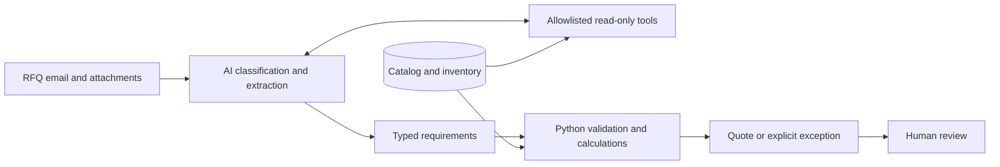

# AI Quoting Agent

### An RFQ becomes a checked quote—or a clear reason to stop.

**AI reads the request. Python checks the business rules. A human owns the decision.**

[](https://github.com/slibberysnek/ai-quoting-agent/actions/workflows/tests.yml)

A Python prototype that turns requests for quotation into reviewable proposals. It combines language-model interpretation with read-only business tools, inventory validation, approved unit conversions, and deterministic pricing and tax calculations.

**[Read the case study](docs/CASE_STUDY.md)** · **[See a real-model quote](examples/live-rfq/standard/proposal.md)** · **[See a real-model stock block](examples/live-rfq/shortage/proposal.md)**

## The business problem

An email asking for “two outers of packing paper and three tape dispensers” carries several jobs: identify the customer and products, translate packaging units, check stock, calculate the price, and surface anything the salesperson must resolve.

This project brings that work into one proposal with supporting evidence. The output includes the original request, extracted requirements, catalog facts, calculations, exceptions, and a draft reply for human review.

## Two real-model runs. Two correct business outcomes.

Both examples used real DeepSeek Flash and Pro inference through **OpenRouter**, with invented Cedar Workshop data. The same customer requested **2 outers of packing paper and 3 tape dispensers**. Only dispenser inventory changed.

| Scenario | Requested / available dispensers | Result | Quote total |
|---|---:|---|---:|
| [Stock available](examples/live-rfq/standard/proposal.md) | 3 / 12 | `quote_ready` | **$90.52 before freight** |
| [Stock shortage](examples/live-rfq/shortage/proposal.md) | 3 / 2 | `insufficient_stock` | **Withheld** |

In each run, the models extracted the original quantities and selected **10 read-only tool calls**. Python then made **9 independent validation lookups**. In the successful case, it converted 2 outers into 20 units and calculated **$84.20 subtotal + $6.32 synthetic tax = $90.52**.

**The stock block is a successful business-rule check.** Python detected that the full quantity was unavailable, retained the request for three units, and withheld the overall quote totals. The reviewer receives an explicit shortage instead of a quote the business cannot fulfill.

Both runs kept email and Teams delivery disabled. The [published audit snapshots](examples/live-rfq/README.md) contain synthetic data and actual extracted drafts. These are two observed examples, not an accuracy benchmark.

## The design decision that matters

**Language interpretation and financial authority have separate interfaces.**

| AI interprets | Python enforces |
|---|---|
| Request intent and unstructured descriptions | Explicit catalog matches and approved unit conversions |
| Product quantities, units, dates, and pricing references | Inventory limits, including repeated lines for the same product |
| Which read-only tools to call | Catalog prices, tax rates, Decimal arithmetic, and rounding |
| Structured requirements with source evidence | Final outcome, financial totals, and rendered proposal |

The model's draft schema has no price, tax, or total fields. The validator repeats its own business-data lookups, independently of the model's research trace. The final response is generated from the validated result.



[Architecture and trust boundaries →](docs/ARCHITECTURE.md)

## Run it locally

Python **3.14** is the tested version. The package declares Python 3.10+; other versions have not been verified.

```sh
git clone https://github.com/slibberysnek/ai-quoting-agent.git
cd ai-quoting-agent
python3 -m venv .venv
source .venv/bin/activate
python -m pip install -c requirements-demo.lock -e '.[dev]'

python -m quote_agent.demo
python -m quote_agent.demo --scenario shortage
python -m quote_agent.demo --scenario malformed-model
```

The default demonstration is an **offline replay with authored model responses**. After dependencies are installed, it needs no API key, Microsoft account, database download, or network access. The real parser, agent protocol, local tools, validator, and renderer execute normally.

Open the generated `proposal.md` and `run.json` under `runs/synthetic-demo/<scenario>/`. A shortage or malformed-response demo succeeds when the expected blocked outcome is observed. [Walkthrough →](examples/synthetic-rfq/README.md)

To use a real model with the same synthetic data, save an OpenRouter key in the ignored local `or_key.txt`, then run:

```sh
python -m quote_agent.live_demo --key-file ./or_key.txt
python -m quote_agent.live_demo --scenario shortage --key-file ./or_key.txt
```

The live runner permits only OpenRouter completion requests, blocks redirects, and initializes no email or Teams delivery adapters. Results are saved in unique ignored run directories. [Live setup, trusted CA configuration, and evidence →](docs/LIVE_DEMO.md)

## Validation

**78 tests pass with the existing historical data.** In a checkout without those optional files, **60 pass and 18 explicitly skip**. GitHub Actions runs the portable suite without secrets or live model requests.

```sh
python -m unittest discover -s tests -v
```

Coverage includes missing information, ambiguous or invalid products, incorrect quantity types, unsupported units, stock shortages, repeated-line inventory demand, inconsistent price/tax data, malformed responses, forged model research, disallowed tools, and integration failures.

The first live attempts exposed incomplete extraction responses. Those attempts were blocked and retained. The handler now separates tool research from final extraction, and the API schema explicitly requires every output field. [Evaluation details →](docs/EVALUATION.md)

## Scope and status

**Working:** local email/attachment parsing, synthetic offline and real-model demonstrations, deterministic financial validation, exception routing, Markdown proposals, and JSON audit records.

**Implemented and mock-tested:** Microsoft Graph ingestion/subscriptions, Azure SQL reads, Teams review posting, and a FastAPI webhook shell. Their combined live operation is unverified.

**Still needed for deployment:** durable processing and retries, cross-request idempotency, explicit approval records, and inventory reservation. Human review must check extraction against the original email. Tax is a sample catalog rule; freight and delivery remain subject to confirmation. There are no production deployment, adoption, or measured savings claims.

[Full implementation status](docs/STATUS.md) · [Cloud adapter configuration](DEPLOY.md)

## Built with

**Python · OpenRouter · Pydantic · SQLite · Decimal · FastAPI · unittest**

The repository also retains the original [Wide World Importers BACPAC-to-SQLite converter](docs/WWI_SQLITE.md). The quoting demo uses its own tiny synthetic database and does not require those downloads.
