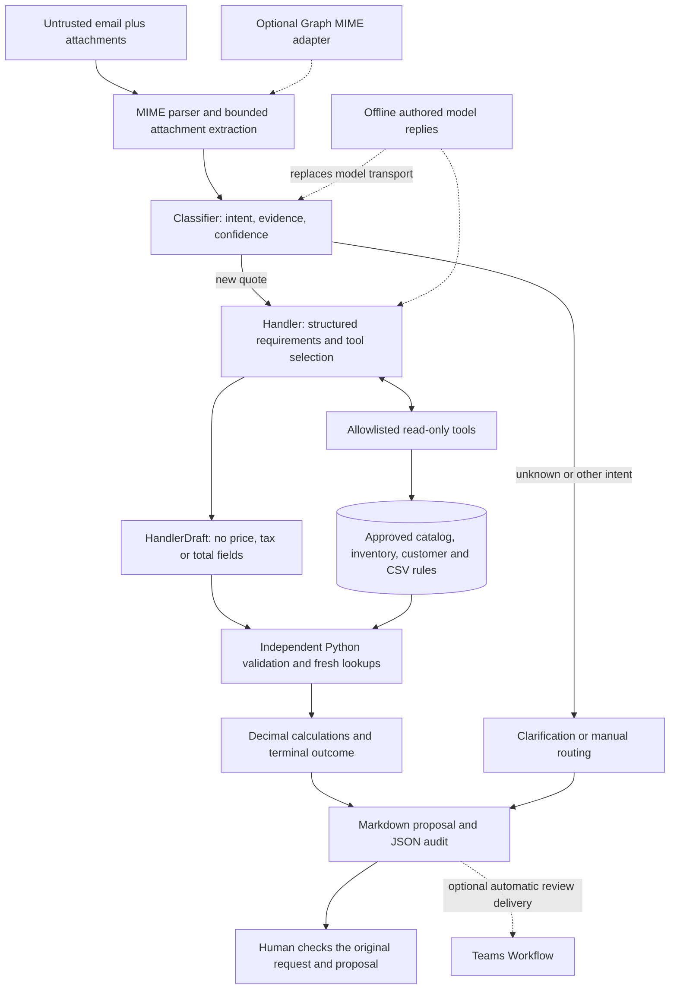

# Architecture and trust boundaries

The system prepares a quote for review. Language interpretation and financial authority have separate interfaces.

## AI interpretation

`RequestClassifier` selects an intent; only a new quote advances to `QuoteHandler`. Unknown intent requests clarification; revisions and other messages are left for manual review. The handler can select six read tools, with at most 12 tool rounds plus a final structured response. Both prompts treat email content as untrusted data.

Pydantic rejects extra fields and nonfinite numbers. Requested quantities must be positive numeric values, not strings or booleans. Schema failure produces `processing_error`. The handler returns descriptions, quantities, units, source evidence and pricing references, not financial results. `suggested_response` is advisory and is not used as the final reply.

## Deterministic authority

`QuotePipeline.resolve` repeats catalog and inventory lookups independently of the agent's trace. An explicit SKU hint is used only if that ID appears in source email/attachment text. Exact IDs, exact normalized names, and curated aliases may resolve automatically; search similarity alone does not. Unknown or ambiguous products need clarification.

Only CSV-listed unit conversions are approved. Normalized quantities must be positive whole stock units. Repeated lines share the available stock count. Price and inventory item IDs and units must agree with the selected product; prices must be nonnegative and tax rates within 0–100. Conflicting repeated prices or invalid catalog values require pricing review. Unknown conversion, incomplete extraction or invalid inventory blocks a ready quote.

Money is calculated with `Decimal(str(value))`: quantity × catalog price, line subtotal rounded to cents using `ROUND_HALF_UP`, then line tax rounded to cents. Totals sum rounded lines. Public result models currently serialize amounts as floats; this is a proposal format, not an accounting ledger. The synthetic 7.5% rate is a fixture assumption, not a tax compliance engine. Contract references require review; discounts are not applied automatically. Freight remains TBD, and delivery is subject to confirmation.

Only `quote_ready` exposes quote-level totals. Other outcomes retain diagnostic line facts but withhold aggregate totals. Reason codes preserve secondary issues even when one primary outcome takes precedence.

## Data and action boundaries

Local SQLite connections use URI read-only mode and `PRAGMA query_only`. SQL is fixed and parameterized. The Azure adapter uses fixed SELECT queries and also requires a read-only database principal. The model has no arbitrary SQL, write, send, or publish tool.

`run.json` separates agent `tool_trace` from deterministic `validation_trace`. Successful validation lookups are recorded with arguments and returned facts. A validator exception preserves the draft and any earlier trace while suppressing raw exception text in the review artifact. This is a local diagnostic record, not tamper-proof compliance logging. Partial handler traces can still be lost if the handler fails before returning.

The offline replay never constructs cloud clients or loads credentials. The live Graph adapter downloads MIME; the web processor automatically posts a Teams review. **There is no implemented approval workflow or customer send action.** Human review is the stopping point of the demonstrated process.

## What these boundaries do not guarantee

The model can still misclassify intent, omit a line, extract a wrong but valid quantity, overlook a pricing reference, or propose a catalog description that differs from the source. SKU grounding checks presence, not a full semantic alignment of every line. Customer name matching is not identity verification. Bounded attachment extraction is not a hardened malicious-document sandbox, and PDF OCR is absent.

The tests prove financial/routing rules for tested inputs. They do not prove semantic extraction accuracy, injection resistance, provider availability, tax applicability, concurrent inventory correctness, or production readiness. The reviewer must compare the proposal with the original email and the business's approved terms.
